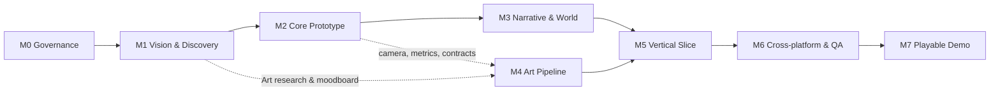

# Roadmap

> **Document Owner:** Claude (Project Lead) · **Approver:** Game Director · **Status:** `UNDER_REVIEW` · **Version:** 0.1 · **Last Updated:** 2026-10-15
> **Related:** [MILESTONES](MILESTONES.md) · [OPEN_QUESTIONS](../00_governance/OPEN_QUESTIONS.md) · [D-0010](../00_governance/DECISION_LOG.md#d-0010--khung-milestone-m0m7-chỉ-thực-thi-m0) · [D-0012](../00_governance/DECISION_LOG.md#d-0012--điều-chỉnh-nhỏ-cho-kế-hoạch-milestone)

Roadmap ở cấp milestone. **Không có ngày tháng, deadline hay ngân sách** — chưa có dữ liệu để ước lượng ([OQ-030](../00_governance/OPEN_QUESTIONS.md)). Chỉ M0 đang được thực thi; M1–M7 là kế hoạch.

---

## 1. Chuỗi milestone

| Milestone | Mục tiêu | Trạng thái |
|---|---|---|
| **M0** Project Governance Foundation | Tổ chức, phân quyền, quy trình, tài liệu | `GATE_REVIEW` |
| **M1** Game Vision & Design Discovery | Chốt quyết định cốt lõi cho prototype | `NOT_STARTED` |
| **M2** Core Gameplay Prototype | Đánh giá cảm giác điều khiển và chiến đấu | `NOT_STARTED` |
| **M3** Narrative & World Foundation | Chuỗi nhiệm vụ đơn giản + lưu tiến độ | `NOT_STARTED` |
| **M4** Art Production Pipeline | Bộ asset mẫu được duyệt và tích hợp | `NOT_STARTED` |
| **M5** Vertical Slice | Một đoạn phiêu lưu hoàn chỉnh | `NOT_STARTED` |
| **M6** Cross-platform & Quality Validation | Chạy ổn định trên cấu hình PC/Android thử nghiệm | `NOT_STARTED` |
| **M7** Playable Demo | GD nghiệm thu bản demo | `NOT_STARTED` |

## 2. Sơ đồ phụ thuộc

Bản text: `M0 → M1 → M2 → M3 → M5 → M6 → M7`; nhánh art `M1 (research) ⇢ M4 → M5`.

## 3. Các luồng song song

| Luồng | Milestone | Điều kiện song song |
|---|---|---|
| **Gameplay & Systems** (Codex) | M2 → M3 | — |
| **Art** (Antigravity) | M1 (research, moodboard) → M4 | M4 sản xuất asset mẫu chỉ sau khi Art Direction `APPROVED` ([OQ-014](../00_governance/OPEN_QUESTIONS.md)) và camera/kích thước nhân vật đã chốt từ M1–M2. Asset contract phải `APPROVED` trước khi Codex tích hợp (P6). |
| **Narrative content** (GD + advisor + Claude) | M1 → M3 → M5 | Nội dung canon chỉ cần cho M5; M3 dùng nội dung thử nghiệm (`EXAMPLE — NOT APPROVED`) để kiểm tra runtime. |

## 4. Critical path và điểm quyết định

| Điểm | Quyết định cần có | Chặn |
|---|---|---|
| Cuối M1 | OQ-001 Vision, OQ-002 Camera, OQ-003 Core loop, OQ-004 Movement, OQ-005 Combat Direction, OQ-006–OQ-011 kỹ thuật | Bắt đầu M2 |
| Trước M3 | OQ-019 Save model, OQ-020 Authoring narrative, OQ-021 Localization | Data contract narrative |
| Trước M4 production | OQ-014 Art Direction, OQ-015 Animation | Asset mẫu |
| Trước M5 | OQ-012/013 Thế giới & cốt truyện, OQ-016–018 Hệ thống nhân vật/kỹ năng/progression, OQ-026 Audio | Vertical Slice |
| Trước M7 | OQ-027 Kênh phát hành, OQ-029 Tên game | Demo build công khai |

## 5. Điều chỉnh đề xuất — `PROPOSED`

Ba điều chỉnh trong [D-0012](../00_governance/DECISION_LOG.md#d-0012--điều-chỉnh-nhỏ-cho-kế-hoạch-milestone) (chờ GD):

1. M1: xác minh năng lực agent (Codex + Unity batchmode; Antigravity + tính nhất quán sprite).
2. M1: Art Direction research + moodboard chạy song song.
3. M2: Android smoke build trên thiết bị thật.

Thứ tự milestone **không đổi**.
